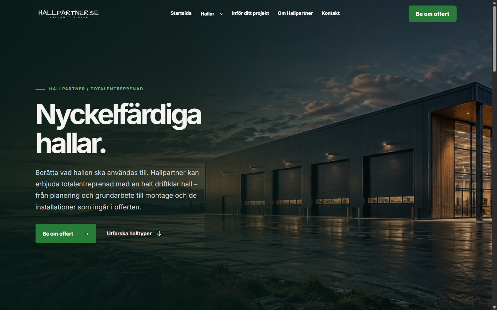
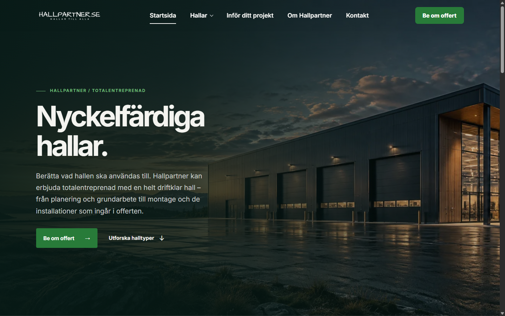
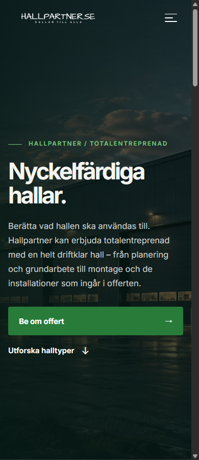
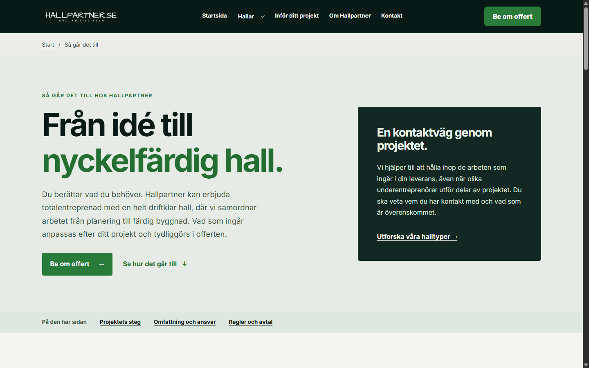
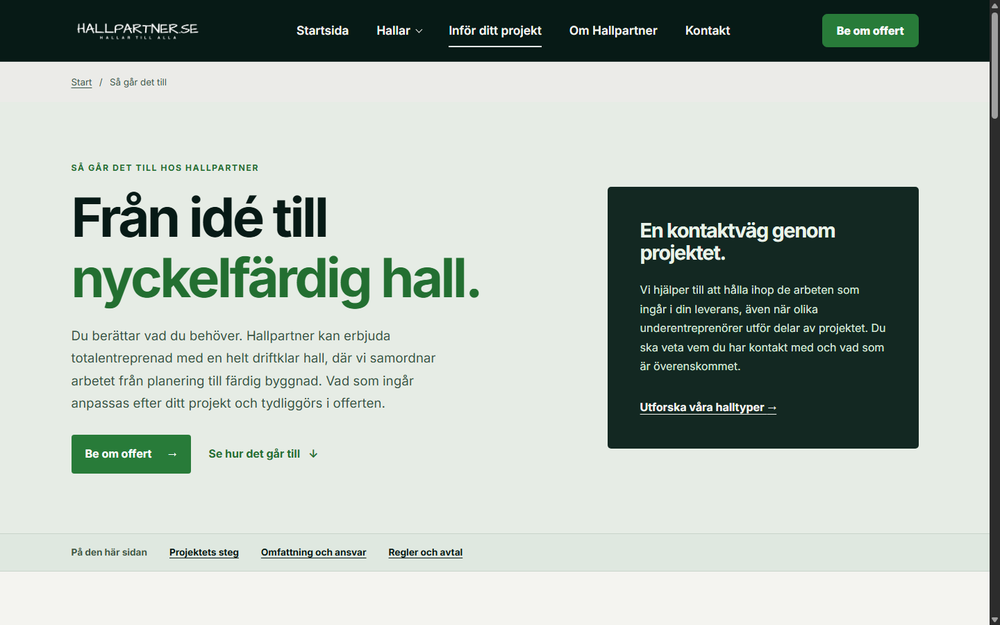
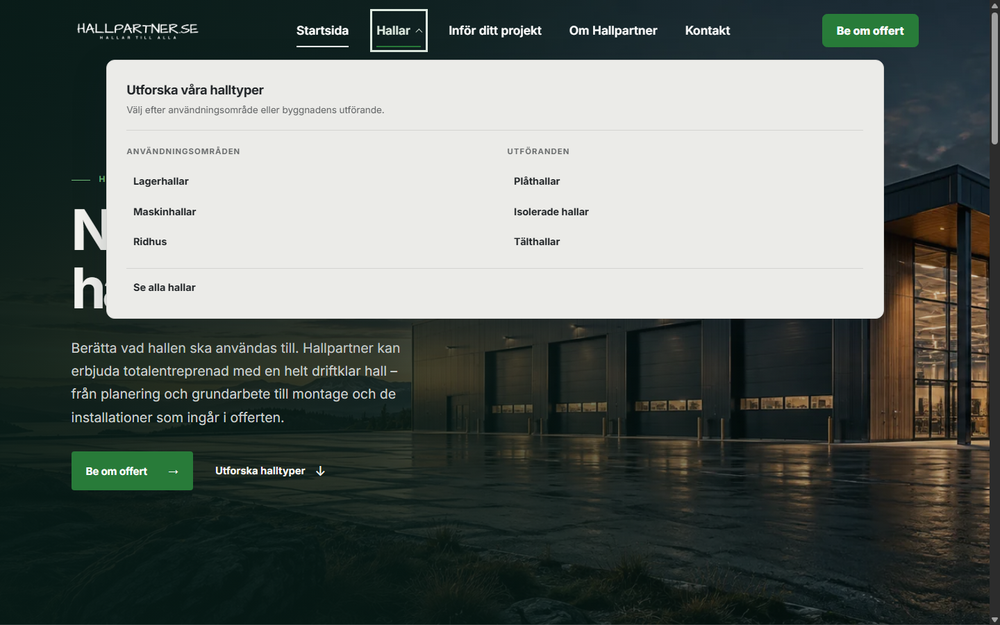

# Hallpartner: AMP-002 Spacious Navigation

Lokal kandidatgranskning 2026-11-06. Ingen merge, ny release, FTP-publicering,
DNS-/WordPress-ändring eller verklig offertförfrågan ingår.

## Verifierad bas och källa

- Hallpartner-bas: `77d1b12652a6b05117939f5dd21dbbdd53774ea5`, hämtad från `main`.
  Ren arbetsmapp före grenbyte; enda worktree var `C:\webbprojekt\hallpartner`.
- Arbetsgren: `codex/amp002-spacious-navigation`.
- Tidigare AMP: `4ee0a081c3d799cd30e3075247fdb98473aa49f6`.
- Godkänd AMP: `2bde176de3509c2ceb4c1bebdf2e69c48120e4d9`, verifierad som
  plattformens `main` innan implementation. [PR #38](https://github.com/Amelio-AB/amelio-web-platform/pull/38)
  och [PR #40](https://github.com/Amelio-AB/amelio-web-platform/pull/40) är mergade.
  [Post-merge CI](https://github.com/Amelio-AB/amelio-web-platform/actions/runs/42225349491) passerade.
- Rotversionen är fortsatt **1.5.0**. Ingen ny npm-/GitHub-release antas eller skapas.
- Lästa live-markören visade `f855a02631dbca5d52da703d3abc0a8ea2e2db63`,
  publiceringskörning `42236416685`. `main` hade redan gått vidare. Workflow
  `316932905` var **active**, med en pågående main-publicering. Statusen lämnades orörd.
  Bilderna här är lokala byggresultat, aldrig bevis för publicerad kandidat.
- Öppna Hallpartner-PR:er vid inventeringen: #1, #2, #4, #6, #7, #9, #25 och #31.
  Äldre header-PR #7 ligger på den pensionerade utvecklingsbasen; ingen kod hämtas därifrån.

## Varför hela paketets källpin kan uppdateras

[Det fullständiga källdiffet](https://github.com/Amelio-AB/amelio-web-platform/compare/4ee0a081c3d799cd30e3075247fdb98473aa49f6...2bde176de3509c2ceb4c1bebdf2e69c48120e4d9)
omfattar två commits och 14 filer. Endast tre distribuerade runtimefiler ändras:
`src/header-menu/index.mjs`, `index.d.mts` och `style.css`. Övriga ändringar är
plattformens dokumentation, exempel, tester och CI. Separat plattforms-PR #31
om innehållsbredd ingår inte.

Alla 32 installerade runtime-/typ-/CSS-filer jämfördes före och efter installationen.
**29 är oförändrade**, vilket också verifierades med identiska Git-blobbar i båda
källcommitterna. Samtliga nya installerade filer matchar godkänd Git-källa efter
enbart CRLF→LF för Windows-checkout. Hashregistret
[`tests/fixtures/amp002-upgrade-sources.json`](../../../tests/fixtures/amp002-upgrade-sources.json)
och Node-testet skyddar den installerade koden mot avvikelser.

| Produkt | Användning i Hallpartner | Resultat |
| --- | --- | --- |
| AMP-001 | Offertguide, adaptrar, CSS och typer | Oförändrade källfiler och kundkonfiguration |
| AMP-003 | Genererad Compact Footer och final CTA | Oförändrade källfiler och kundkonfiguration |
| AMP-006 | Expanderande hallkort | Oförändrade källfiler; browserregression |
| Hero-produkter | Paketets hero-moduler | Oförändrade källfiler; Hallpartners hero lämnas orörd |

`npm install --package-lock-only --ignore-scripts --no-audit --no-fund` genererade
låsfilen; `npm ci --ignore-scripts --no-audit --no-fund` verifierade ren installation.
Endast AMP-posten ändras i låsfilen, inklusive npm-genererad integritet.
Inga nya beroenden, kopierade AMP-källfiler eller kundändringar i plattformen.

## Integration och kundanpassningar

- `SiteHeader.astro` behåller `classic-mega-menu`, ikonhamburgare och
  serverrenderad reservnavigation. `navigationAppearance: 'spacious'` är explicit.
- AMP:s standardtypografi, adaptiva mellanrum, 88 px desktopheader och aktiva
  understrykning används utan egna font-/gap-tokens eller vertikala avdelare.
- Headerns maxbredd **1268 px** behålls. Normal desktop får plats även vid 1025 px.
  Vid förstorad standardtext använder AMP sin befintliga rem-baserade mobilbrytpunkt.
- Hallpartners `#071A16`, `#F4F4F0`, `#287B39` och `#EBEBE8`, logotyp, samtliga
  sex hallkategorier och **Be om offert** bevaras. Aktiva länkar ärver ljus text;
  inga gröna kundspecifika länkar från andra projekt förs in.
- Desktopmenyns tangentbordsfokus använder `currentColor` så ramen är tydlig
  både över mörk hero och på solid header. Undermenyn behåller sitt ljusa tema.
  Beräknad kontrast på solida ytor: headertext **16,30:1**, undermeny **13,09:1**,
  vit CTA-text mot grönt **5,27:1**. Transparent hero har också granskats visuellt.
- Zoomtestet hittade att Hallpartners tidigare logo-/railregler åsidosatte AMP:s
  regler vid mycket smal effektiv vy. `max-width:min(9.5rem,100%)` och återställda
  gränser vid `15rem` håller ikon och logotyp inom headern vid 200 % textstorlek.
  Ingen ny mobilmeny eller ändring i AMP:s beteendekod behövs.
- SHA-spärrarna i `ci.yml`, `amp-readiness.yml` och `scripts/preview/policy.mjs`
  följer samma nya pin. Publiceringsflödets triggers, destinationer och säkerhetsgrindar
  ändras inte. Den befintliga lokala browserkedjan får en extra AMP-002-regression.

## Testning

- Astro/TypeScript: 0 fel, 0 varningar, en befintlig oanvänd-import-hint i
  `tests/hall-concept-photos.test.mjs`. ESLint passerar.
- 119 Node-tester passerar, inklusive offertflöde, header, footer, AMP-006,
  publiceringspolicy och installerade källhashar.
- Statiskt Astro-bygge: 15 avsedda HTML-sidor enligt aktuell policy.
  HTML-/metadata-/URL-kontroller passerar med befintlig releasepolicys byggflaggor.
  Första lokala bygget utan dessa flaggor stoppades korrekt av policykontrollen;
  inga konfigurationsfiler eller aktiveringsbeslut ändrades.
- Ny Chrome-QA: **40 kombinationer** av startsida/solid undersida, 100/200 %
  standardtext och 320, 390, 768, 1024, 1025, 1100, 1200, 1280, 1440, 1920 px.
  Kontrollerar verkligt monterad Spacious, textstorlek, logo-/meny-/CTA-gränser,
  klippning, fokus, Enter, Escape, hover, scroll och sidhuvudets yta.
- Sidbyte via faktisk hallänk, `history.back()`/`forward()`, aktuell hallsektion
  och direktlänk. Grupperad knapp får aldrig `aria-current="page"`.
- Mobilmenyn öppnas med native touch; tangentbordsfokus lämnar inte dialogen
  för sidans inaktiva länkar. Browserns egen verktygsrad tillåts av native dialog.
  Escape stänger omedelbart när reduced motion är aktivt.
- Befintlig Chrome-granskning av startsida och solid undersida på sex bredder,
  med mobilikon, dialog, scrollås, fokusåtergång, bildladdning och no-JS-navigation.
- AMP-006 och galleri passerar sina befintliga fem-bredders browserregressioner,
  inklusive tangentbord, touch, reduced motion och no-JS.
- Inga API-anrop eller offertinskick görs. Browsergranskningen blockerar `/api/*`.
  PHP/SMTP verifieras med projektets isolerade CI-tester; privat live-mottagning berörs inte.

Reproducerbart: bygg projektet, starta `npm run preview -- --host 127.0.0.1 --port 4321`
och kör `node scripts/verify-hallpartner-amp002.mjs`. Windows använder `HP_CHROME`
med sökvägen till Chrome. Testet ändrar browserns standardfont 16→32 px och
verifierar computed root-font; det är inte en större screenshot eller ökad pixelratio.
JSON och bilder skrivs till `reports/amp002/after/`. CI kör samma test på det
statiska payloadet och sparar under `preview-evidence-…/chrome/amp002`.

## Visuell granskning

Före-bilderna kommer från bygget på bascommitten ovan med gamla paketet.
Efter-bilderna visar kandidaten. Normal mobil behåller sitt utseende.
Desktoptexten är tydligare och luftigare; CTA och logotyp har fortsatt egna utrymmen.

| Före | Efter |
| --- | --- |
|  |  |
|  |  |
|  |  |

## Gränser och beslut inför merge

Detta är kandidat-QA i Chrome på Windows samt automatiska CI-kontroller. Fysisk
iOS/Safari, Android och skärmläsare är inte verifierade. Headern klarar 200 %
standardtext; startsidans befintliga hero-copy kan fortfarande klippas på extremt
smal vy med denna textinställning. Hero-layouten är oförändrad och en separat
tillgänglighetsuppföljning behövs; detta är inte ett generellt WCAG-intyg för sidan.

Live-granskning av den nya headern återstår till separat godkänd merge/publicering.
Draft-PR:n ska behållas tills exakt PR-HEAD har gröna obligatoriska checks och
ägaren har granskat bilderna. En merge till `main` kan starta Inleed-publicering;
den ingår inte i uppdraget.
